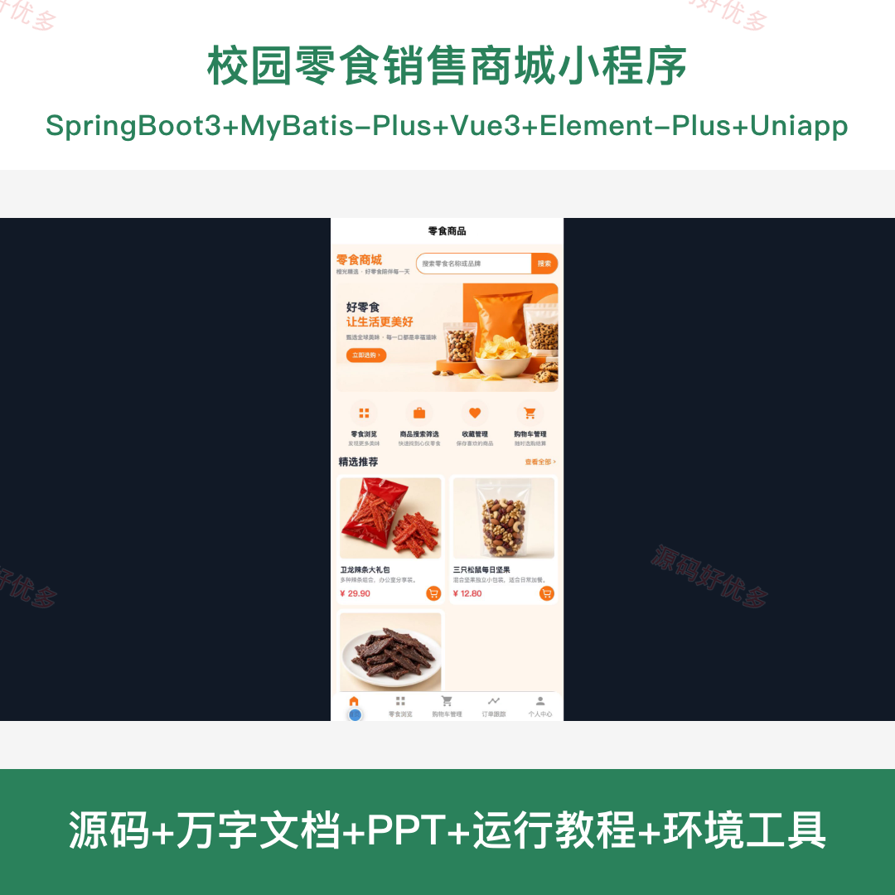
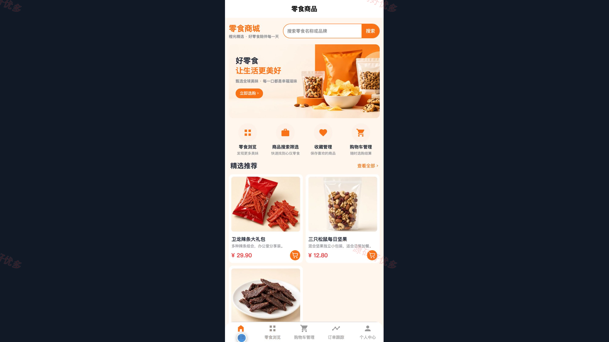
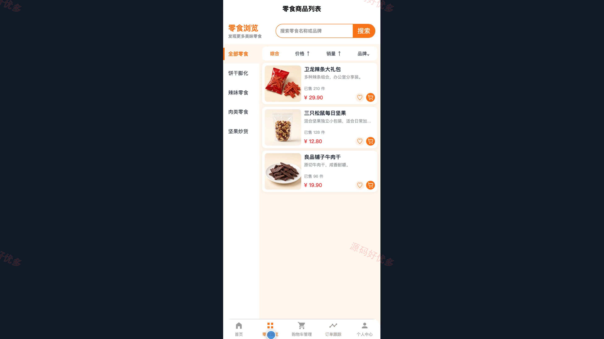
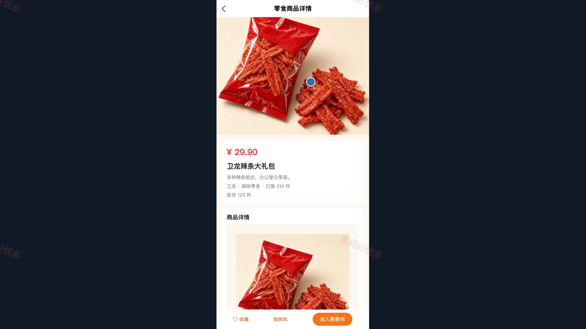
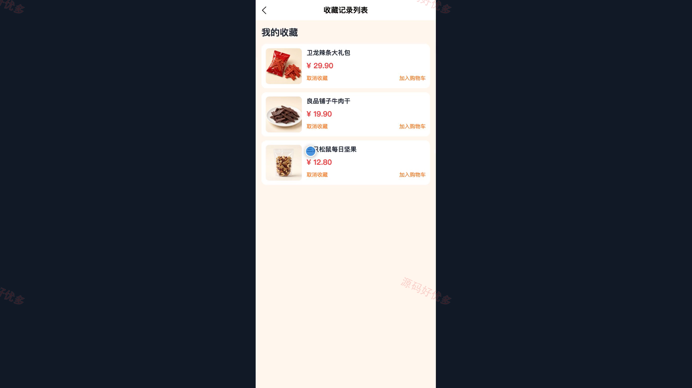
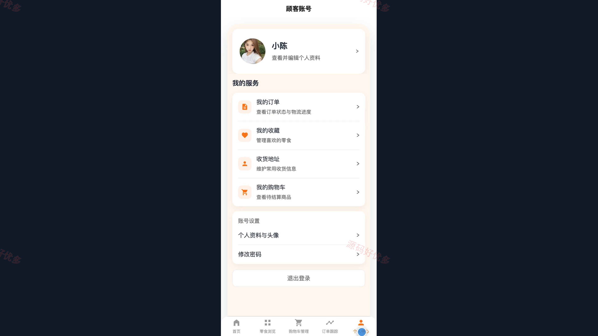
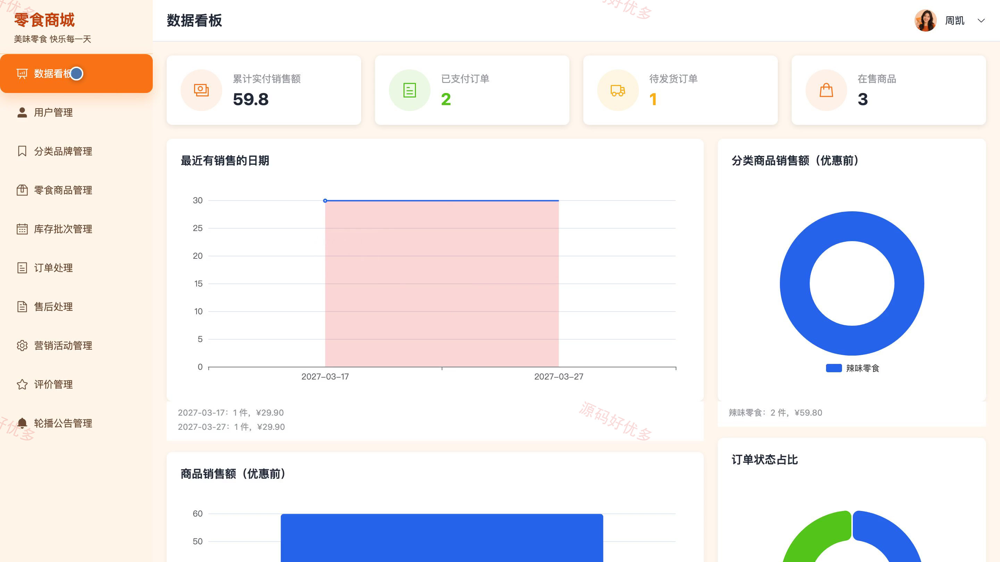
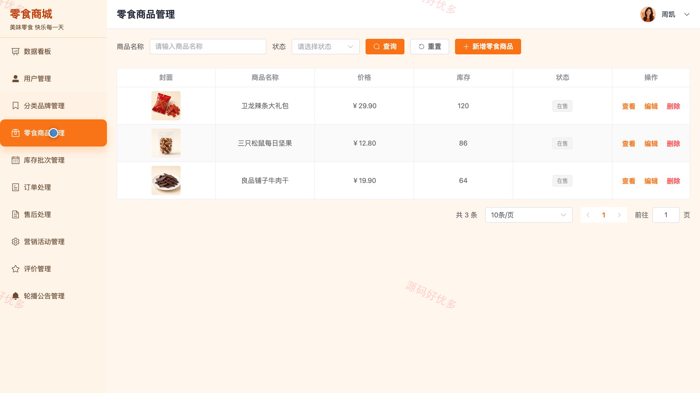
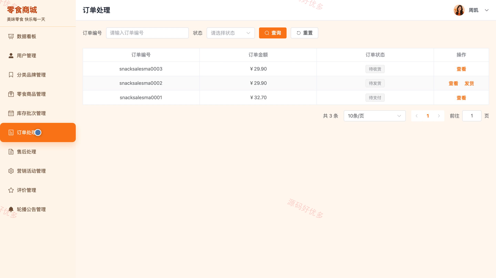

# bs123B
bs123B零食销售商城系统
## 源码问题查看主页咨询

### 一、关键词
校园零食商城、校园购物、零食网购、宿舍零食、零食配送

### 二、作品包含
源码+数据库+万字设计文档+PPT+全套环境和工具资源+本地部署教程

### 三、项目技术
前端技术： Html、Css、Js、Vue3.4、Element-Plus、uniapp
后端技术：Java、SpringBoot3.2.0、MyBatis-Plus

### 四、运行环境要求
开发工具：IDEA/eclipse + VSCODE + HBuilder X + 微信开发者工具

数据库：MySQL5.7+（共19张表）

数据库管理工具：Navicat10以上版本

环境配置软件： JDK17 + Maven3.6

前端Nodejs：16+

浏览器：谷歌浏览器

### 五、项目介绍
项目编号：bs123B

面向校园零食选购场景，顾客可在小程序浏览商品、加入购物车、提交订单并查看配送进度；管理员通过后台维护商品、库存、订单和营销内容。

角色：用户、管理员

用户功能：注册登录与个人资料管理、零食浏览与筛选、商品收藏与购物车管理、收货地址维护与订单结算、模拟支付与订单跟踪、商品评价与售后申请。

管理员功能：用户账号管理、零食分类与品牌管理、零食商品管理、库存批次管理、订单与售后处理、营销活动与优惠配置、评价与公告管理、销售数据统计。

### 六、运行截图

